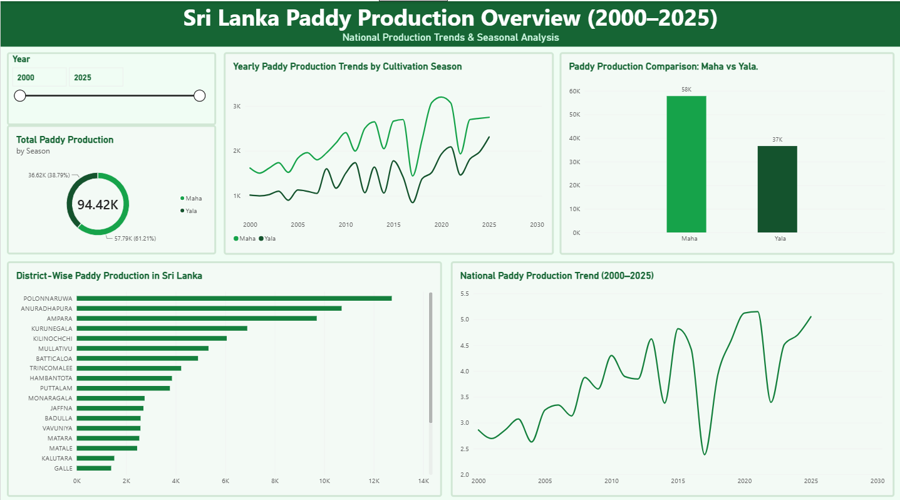
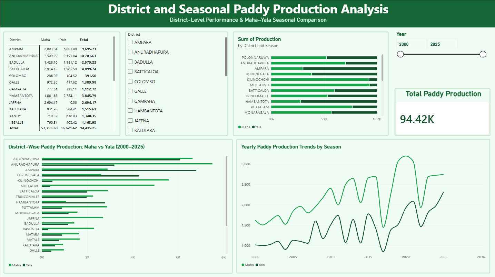

# Sri Lanka Paddy Production Analysis (2000–2025)

## Project Overview

This project presents an interactive Power BI dashboard exploring Sri Lanka's paddy production from 2000 to 2025. It focuses on national production trends, district-level performance, and comparisons between the Maha and Yala cultivation seasons.

## Project Objectives

- Analyze national paddy production trends.
- Compare Maha and Yala seasonal production.
- Explore district-level production performance.
- Present agricultural data through interactive visualizations.

## Tools and Technologies

- Microsoft Power BI Desktop
- Power Query
- Microsoft Excel
- CSV datasets
- Data Modeling
- Data Visualization

## Dashboard Features

- Interactive year range slicer
- District-level filtering
- National production trend analysis
- Maha and Yala seasonal comparison
- Total production KPI card
- District-level production matrix
- Percentage-based seasonal comparison

## Dashboard Preview

### Page 1 – National Overview

### Page 2 – District and Seasonal Analysis

## Repository Structure

- `Dashboard/` – Power BI dashboard file
- `Dataset/` – Source and processed datasets
- `Screenshots/` – Dashboard preview images
- `README.md` – Project documentation

## Data Sources

- [Department of Census and Statistics – Sri Lanka](https://www.statistics.gov.lk/Agriculture/StaticalInformation/PaddyStatistics) – Historical district-level paddy production data for Maha and Yala cultivation seasons.

- [Macro Lab – Paddy Statistics](https://macrolab.lk/data/agriculture-and-fisheries/paddy/) – Historical national paddy production statistics.

The analysis focuses on the period from 2000 to 2025.

## Key Findings

- Maha season contributed 61.21% of total paddy production,
  compared to 38.79% from the Yala season.
- The three leading paddy-producing districts were
  Polonnaruwa, Anuradhapura,and Ampara.
- National paddy production experienced its lowest
  level in 2017.
- National paddy production changed from 3.39 million metric tons in 2022 to 5.05 million metric tons in 2025.

## How to Use

1. Download the Power BI file from the Dashboard folder.
2. Open the file using Microsoft Power BI Desktop.
3. Explore the dashboard using the year and district slicers.
4. Update the data source paths if required when refreshing the data.

## Project Purpose

This project demonstrates practical skills in business intelligence, data preparation, data modeling, interactive dashboard development, and agricultural data analysis.
